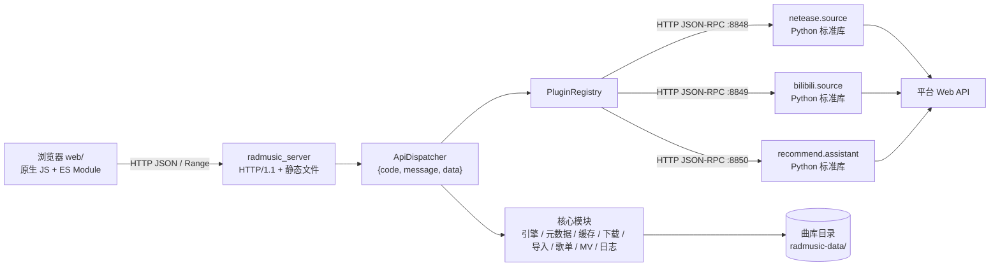

# Rad Music

> 自托管音乐库 · **C++17 后端（零第三方依赖）** + **Material Design 静态 Web UI** + **网易云 / 哔哩哔哩 / 智能推荐**音源插件

[中文](#中文) · [English](#english)

<p align="center">
  <a href="https://github.com/zbl201054/rad-music/releases"></a>
  <a href="https://github.com/zbl201054/rad-music/stargazers"></a>
  <a href="https://github.com/zbl201054/rad-music/network/members"></a>
  <a href="https://github.com/zbl201054/rad-music/releases"></a>
  <a href="https://github.com/zbl201054/rad-music/issues"></a>
  <a href="https://github.com/zbl201054/rad-music/blob/main/LICENSE"></a>
  <a href="https://github.com/zbl201054/rad-music"></a>
  <a href="https://github.com/zbl201054/rad-music/commits"></a>
  <a href="https://github.com/zbl201054/rad-music/actions/workflows/build.yml"></a>
</p>

---

## 中文

一套可自托管的「本地 + 在线」音乐库：**C++17 后端（零第三方依赖）** + **无框架静态 Web UI** + **外部进程音源插件**。

后端负责曲目元数据、缓存、加载/播放状态、歌词、下载、导入、歌单/专辑/MV、日志与 HTTP API；前端是一个由后端直接托管的静态页面，用浏览器原生 `<audio>` 播放；在线音源通过「播放源插件」接入，仓库内已带网易云音乐、哔哩哔哩与智能推荐三个插件。

> 当前状态：接口标准 **API v0.11** 已实现，并包含 **v0.12** 的检查更新（GitHub Releases 检查 / 下载 / 覆盖重启）增量；**应用发布版本**见上方 Release 徽章（当前 v0.1.1）。接口定义见 [`api/Readme.md`](api/Readme.md)，实现说明见 [`api/IMPLEMENTATION.md`](api/IMPLEMENTATION.md)。

### 目录

- [功能特性](#功能特性)
- [架构](#架构)
- [目录结构](#目录结构)
- [快速开始](#快速开始)
- [插件机制](#插件机制)
- [HTTP API](#http-api)
- [数据目录](#数据目录)
- [测试](#测试)
- [已知限制](#已知限制)
- [常见问题](#常见问题)
- [文档](#文档)
- [规模](#规模)
- [许可证](#许可证)

### 功能特性

| 模块 | 能力 |
| --- | --- |
| 曲库 | 多音源曲目统一展示，同曲折叠；按音源、音质、标题/歌手/专辑/时长筛选与排序；一键播放全部 |
| 搜索 | 跨多个音源并发搜索，±3 秒时长容差折叠同一首歌；可按音源、最低音质、时长区间、仅可播放过滤，支持分页 |
| 播放 | 浏览器 HTML5 `<audio>` + HTTP Range（可拖动进度）；自动/手动选音质；播放队列、上一首/下一首、音量 |
| 歌词 | 标准/增强 LRC、翻译、罗马音三轨同步，播放页与播放条双处高亮；在线歌词可回退到插件 |
| 歌单 / 专辑 | 引用式存储（只存曲目引用，不复制音频），保序、幂等去重、原子写；支持批量加入与编辑 |
| MV | 与曲目同构的 `mv/<sha>/` 目录，`sha` 与 `(platform, item_id)` 双唯一，支持搜索与播放地址解析 |
| 下载 | 任务队列、同曲同质去重、校验后落盘 `tracks/` 并入索引（网络取流需宿主注入，见「已知限制」） |
| 导入 | 扫描本地音乐，解析 ID3v2 / FLAC / MP4 / APE / WAV / Ogg 标签与音频参数，失败回退文件名；冲突检测、dry-run 报告 |
| 缓存 | meta/audio/stream/lyric/cover/tmp 分层统计，分层限额、LRU 淘汰、按条目重建，清理不碰用户数据 |
| 调音 | 10 段 EQ、前置增益、预设保存；参数层已实现，音频处理链由宿主或音效插件接入 |
| 智能推荐 | 每日推荐、漫游（发现）、探索、相似歌曲、心情电台、推荐流、偏好与反馈（由 `recommend` 插件提供） |
| 系统集成 | SMTC 元数据/状态/时间轴上报接口；运行日志分级分类、文件轮转与内存环形缓冲 |
| 设置 | 6 套主题 × 深浅色、播放器圆角/紧凑模式、默认音质、折叠/隐藏不可用、插件启停、缓存、日志、API 文档 |
| 更新 | 设置页「版本」从 GitHub Releases 拉取版本号与发布历史，支持 `release` / `dev` / `canary` 频道检查与下载；多线程分段下载本平台安装包（线程数可调 1–16）、校验后解压覆盖并重启（数据与设置不受影响） |

### 架构



三层职责：

1. **核心库**（`api/include/radmusic/`、`api/src/`）：纯 C++17，自带 JSON、SHA-256、MD5、HMAC、PBKDF2、Base64、AES-256-GCM，不链接任何第三方库。可直接链接进桌面播放器，也可经 HTTP 暴露。
2. **HTTP 服务端**（`api/tools/radmusic_server.cpp`）：把各模块接线为可执行程序，自带 WinSock/POSIX 传输层与静态文件服务，同时负责扫描、拉起并代理音源插件。
3. **Web UI**（`web/`）：无构建步骤、无框架。`app.js` 负责外壳/播放器/路由，`views.js` 负责页面，`settings.js` 负责设置，`api.js` 负责请求与格式化，`styles.css` 使用 MD3 变量。

### 目录结构

```text
Rad music/
├─ api/
│  ├─ Readme.md              # API 标准（数据模型、接口、错误码、插件标准）
│  ├─ IMPLEMENTATION.md      # C++ 实现说明（章节映射、测试、兼容性）
│  ├─ CMakeLists.txt         # CMake 构建（可选）
│  ├─ Makefile               # MSYS2/MinGW 便捷构建（Windows 实测）
│  ├─ include/radmusic/*.hpp # 头文件：错误码、JSON、加密、音质、模型、存储、插件、歌词、引擎…
│  ├─ src/*.cpp              # 对应实现
│  ├─ tests/                 # 零依赖测试框架 + 测试文件
│  ├─ tools/radmusic_server.cpp  # HTTP 服务端入口
│  ├─ build/                 # 构建产物（radmusic_server / radmusic_server.exe）
│  └─ radmusic-data/         # 开发用曲库数据（可换成任意目录）
├─ web/                      # 静态前端（index.html / app.js / views.js / settings.js / api.js / icons.js / styles.css）
└─ plugins/
   ├─ netease/               # 网易云音乐播放源插件（main.py + plugin.json + README.md）
   ├─ bilibili/              # 哔哩哔哩播放源插件（main.py + plugin.json + README.md）
   └─ recommend/             # 智能推荐插件（每日推荐 / 漫游 / 相似 / 心情电台，main.py + plugin.json + README.md）
```

### 快速开始

#### 依赖

- **编译器**：支持 C++17 的 g++ / clang++ / MSVC（Windows 上推荐 MSYS2 MinGW-w64，实测 g++ 16.1.0）
- **构建工具**：`mingw32-make`（Windows）或 `make`；也可用 CMake ≥ 3.16
- **Python 3**：仅音源插件需要，且只用标准库（网易云默认端口 8848，B 站 8849，智能推荐 8850）
- 可选：`curl` 用于命令行调试接口

> 不想自己编译？从 [Releases](https://github.com/zbl201054/rad-music/releases) 下载对应平台的预编译包（Windows x64 / Linux x86_64 / macOS arm64 + x86_64），解压即用。

#### 编译

```bash
cd api

# 方式一：Makefile（Windows / MSYS2）
mingw32-make server     # 只编译服务端
mingw32-make            # 服务端 + 测试

# 方式二：CMake
cmake -S . -B build-cmake && cmake --build build-cmake
```

Windows 上 HTTP 传输层需要链接 `ws2_32`，Makefile 与 CMakeLists 已处理。改过 `.hpp` 后若出现随机崩溃，请先 `mingw32-make clean`（旧的 `.o` 与新的类布局混链会导致堆损坏）。

#### 运行

```bash
# 在仓库根目录
api/build/radmusic_server --root api/radmusic-data --web web --port 8765
```

```bash
# Windows 路径写法
api\build\radmusic_server.exe --root api\radmusic-data --web web --port 8765
```

打开 <http://127.0.0.1:8765/> 即可使用。`--web` 省略时会在 `web`、`../web`、`../../web` 中自动探测含 `index.html` 的目录。

没有音源、只想看界面和链路是否正常：

```bash
api/build/radmusic_server --demo --root api/radmusic-data --web web
```

`--demo` 注册一个内置演示播放源（合成曲目、无网络依赖），可用于联调搜索、折叠、音质与歌词。

> **关于插件目录**：从仓库根目录运行时，服务端会自动扫描 `plugins/`（以及向上两级的 `plugins`）与 `<root>/plugins/` 下的 `plugin.json`，无需额外参数。若把可执行文件复制到其它目录（例如本地盘的 `%LOCALAPPDATA%\RadMusic\`）再运行，自动扫描会失效，此时必须用 `--plugin-dir` 显式指向插件目录：`--plugin-dir "G:\Rad music\plugins"`（路径按你的实际位置填写）。

#### 接入音源

1. 启动服务后，服务端会扫描 `plugins/*/plugin.json`，并按清单里的 `command` 自动拉起插件（需要 `python` 在 `PATH` 中，可用 `--no-plugin-autostart` 关闭）。
2. 在「设置 → 音源」查看各音源是否就绪，点「刷新音源信息」重新探活。
3. 网易云登录（可选，用于提升音质与解锁 VIP 曲目）：浏览器打开 <http://127.0.0.1:8848/login>，用手机 App 扫码确认，凭据会写入 `plugins/netease/cookie.txt`。
4. 回到「搜索」页输入关键词即可跨源搜索；本地文件走「导入」页扫描入库。

#### 命令行参数

| 参数 | 默认值 | 说明 |
| --- | --- | --- |
| `--root <dir>` | `radmusic-data` | 曲库根目录（数据、缓存、日志、插件清单都在这里） |
| `--host <ip>` | `127.0.0.1` | 监听地址；没有鉴权，不要直接绑 `0.0.0.0` |
| `--port <n>` | `8765` | HTTP 端口，同时提供页面与 API |
| `--web <dir>` | 自动探测 | 静态页面目录 |
| `--demo` | 关 | 注册内置演示播放源 |
| `--plugin-dir <dir>` | — | 额外的插件目录，可重复（异地运行时必须显式指定） |
| `--no-plugin-autostart` | 关 | 不自动拉起插件进程 |
| `--io-timeout <ms>` | `5000` | 连接读写超时 |
| `--log-level <lvl>` | `info` | `trace/debug/info/warn/error/off` |
| `--log-file <path>` | `<root>/logs/radmusic.log` | 日志文件（8 MiB 轮转） |
| `--no-log-console` | 关 | 不向控制台输出日志 |

### HTTP API

所有业务接口返回统一结构，HTTP 状态码只表示传输层结果：

```json
{ "code": 0, "message": "ok", "data": {} }
```

`code = 0` 成功；`1001–1032` 为业务错误（平台错误、base 冲突、音质未定义、歌单不存在等），完整列表见 [`api/Readme.md` 第 3 节](api/Readme.md#3-错误码补充)。

| 接口组 | 方法与路径 | 说明 |
| --- | --- | --- |
| 加载 | `POST /music/load` | 按 `sha` / `platform+id` 加载曲目；`base.json` 缺失先重建，`secret=1` 走解密 |
| 播放 | `POST /music/start\|pause\|resume\|stop\|seek`、`GET /music/status` | 播放控制与状态机 |
| 音频流 | `GET /music/audio/{sha}` | 发送音频文件，支持 `Range`（206） |
| 元数据 | `GET /music/info`、`POST /music/verify` | 当前曲目元数据 / 校验解密口令 |
| 曲库 | `GET /music/library` | 列出已入库曲目（可按 `platform` 过滤） |
| 曲库 | `DELETE /music/library/{sha}` | 从曲库移除：`delete_file=false` 只删记录（默认 `true`，连带删除 `tracks/<sha>/` 下的音频）；`all=true` 连同同一首歌的其它音质版本；歌单 / 专辑引用与失效的下载任务一并清理 |
| 搜索 | `GET\|POST /music/search` | 多源聚合搜索、折叠、筛选、分页 |
| 多源请求 | `POST /music/request` | 统一路由到具备对应能力的播放源插件 |
| 歌词 | `GET /music/lyric` | 归一化歌词（原文/翻译/罗马音） |
| 音质 | `GET /music/quality` | 各音源声明的音质定义与曲目可用音质 |
| 缓存 | `GET\|POST /music/cache*` | 统计、清理、重建、限额配置 |
| 下载 | `POST\|GET\|DELETE /music/download` | 任务创建/查询/暂停/取消 |
| 打开所在文件夹 | `POST /music/open-folder`（别名 `POST /music/download/{id}/open-folder`） | 在系统文件管理器中定位文件：body 三选一 `task_id` / `sha` / `path`，都不给则打开曲库 `tracks/` 目录 |
| 导入 | `POST\|GET /music/import*` | 扫描、开始、状态、取消、冲突报告 |
| 调音 | `GET\|POST /music/eq`、`/music/dsp/*` | EQ 参数与预设 |
| 歌单 | `GET\|POST /music/playlist*` | 列表、创建、增删曲目、批量加入 |
| 专辑 | `GET\|POST /music/album*` | 同上，另有从曲库批量选取与元信息编辑 |
| MV | `GET\|POST /music/mv*` | 搜索、详情、加入与播放地址 |
| 日志 | `GET /music/logs`、`POST /music/logs/level` | 读取内存日志、运行时改级别 |
| 插件 | `GET\|POST /music/plugins*` | 列出、注册、启停插件 |
| 推荐 | `GET\|POST /music/recommend*` | 每日推荐 / 漫游 / 相似 / 心情电台 / 偏好与反馈（由 `recommend` 插件提供） |
| 设置 | `GET\|POST /music/settings` | 读写 `settings.json` |
| 数据 | `GET /music/data`、`POST /music/data/purge` | 按分类统计占用 / 清除全部数据（需 `confirm: "PURGE"`） |
| 检查更新 | `GET /music/update`、`POST /music/update/{check\|download\|apply}` | 拉取 GitHub Releases 的版本信息与发布历史、按频道（`release`/`dev`/`canary`）比对版本、分片下载本平台安装包、解压覆盖并重启（需 `confirm: "UPDATE"`）；下载支持多线程（`threads` 1–16）；详见 [`api/Readme.md` 2.20](api/Readme.md) |

示例：

```bash
curl http://127.0.0.1:8765/music/status

curl -X POST http://127.0.0.1:8765/music/search \
     -H "Content-Type: application/json" \
     --data-binary '{"keyword":"海阔天空"}'
```

> Windows 的 `curl.exe -d '{...}'` 容易被 shell 吞掉引号，建议把 JSON 写进文件后用 `--data-binary @body.json`。

### 数据目录

```text
<root>/
├─ tracks/<sha>/            # 已入库音频（持久），sec.json / lyric.lrc 也在这里
├─ tracks/.staging/         # 原子提交暂存
├─ covers/<hash>.<ext>      # 封面存档
├─ index/index.json         # 库索引（唯一键 → 路径，与磁盘不一致时以磁盘为准）
├─ library/                 # 用户数据：playlists/<id>.json、albums/<id>.json
├─ mv/<sha>/mv.json         # MV
├─ presets/eq/              # EQ 预设
├─ logs/radmusic.log        # 运行日志（+ .1 轮转）
├─ settings.json            # 主题、音量、默认音质、插件开关等
├─ plugins/<id>/plugin.json # 通过设置页注册的插件清单
└─ cache/                   # 可随时清理
   ├─ meta/<song_key>/<quality_key>/base.json   # 元数据：一首歌一个文件夹、每个音质一个文件夹
   ├─ audio/ stream/ lyric/ cover/ tmp/
```

关键设计：

- **`base.json` 放在缓存里，不在音频目录**。路径本身即唯一键：`song_key`（歌曲）+ `quality_key`（音源+音质），不同音质天然落在不同目录，结构上不可能互相覆写。
- **写入前读-比较-再写**：内容相同 → `skipped`，可补全字段 → `merged`，同曲同质但内容不同 → `1023 base conflict` 且默认拒绝覆写；提交时先写同目录 `.tmp` 再同卷原子替换。
- **缓存可清理，用户数据不可清理**：`tracks/`、`library/`、`mv/`、`presets/`、`logs/` 不会被 `cache clear` 或 LRU 淘汰删除；`base.json` 可由索引 + 音频/在线源重建到同一路径。

### 插件机制

播放源插件是**独立进程**，通过本地 HTTP JSON-RPC 与宿主通信；`plugin.json` 声明平台、能力、音质与启动命令。**仓库内每个插件占 `plugins/` 下的一个子目录**（`plugin.json` + `main.py` + `README.md`），当前全部为 `type: "source"`。

```json
{
  "id": "netease.source",
  "name": "网易云音乐",
  "type": "source",
  "platforms": ["netease"],
  "api_version": "1",
  "entry": "main.py",
  "transport": "http",
  "endpoint": "http://127.0.0.1:8848",
  "command": ["python", "main.py", "--port", "8848"],
  "capabilities": ["search", "get_song", "get_url", "get_qualities", "get_lyric", "get_pic"]
}
```

- 插件只需实现 `GET /health`、`POST /request`（`{"op": "...", "params": {...}}`），可选 `GET /login` 提供登录页。
- 宿主按 `capabilities` 路由 `request`，未声明的 op 返回 `1012`；音质等级由插件声明，宿主只做归一化比较，不编造平台音质。
- 宿主会扫描插件目录下**每个子目录的 `plugin.json`**（`transport` 必须是 `http` 且有 `endpoint`），清单校验失败则跳过并记日志。
- 新增音源 = 在 `plugins/` 下加一个目录 + `plugin.json` + 实现，无需改动后端。

**已内置的三个插件：**

| 插件 | 端口 | 平台 | 类型 | 主要能力 |
| --- | --- | --- | --- | --- |
| `netease.source`（网易云音乐） | 8848 | netease | source | 搜索/歌曲/播放地址/音质/歌词/封面/歌单/专辑/歌手/MV/登录 |
| `bilibili.source`（哔哩哔哩） | 8849 | bilibili | source | 搜索/歌曲/播放地址/音质/歌词/封面/歌单/MV/登录 |
| `recommend.assistant`（智能推荐） | 8850 | recommend | source | 每日推荐/漫游/探索/相似/心情电台/推荐流/偏好/反馈 |

> 仓库早期文档曾建议按 `plugins/source/`、`plugins/function/` 分层摆放，但该约定从未在代码中落地，实际始终为扁平目录。本文档以当前代码结构为准。

### 测试

```bash
cd api
mingw32-make test                 # 编译并运行全部用例
mingw32-make test FILTER=storage  # 只跑名字含 storage 的用例
build/radmusic_tests -v           # 列出每个用例名（Windows 为 radmusic_tests.exe）
```

覆盖 JSON、加密原语（已知答案向量）、存储防覆写与原子写、歌词三轨、搜索折叠、标签解析、引擎状态机、缓存策略、下载、导入、API 路由与错误码、HTTP 传输层、日志、歌单/专辑/MV。当前结果（`g++ 16.1`，`-Wall -Wextra` 零警告）：

```text
合计: 167 个用例, 通过 167, 失败 0
```

### 已知限制

1. **单用户、无鉴权**：默认只监听 `127.0.0.1`。对外提供服务请放在反向代理后并自行加认证。
2. **传输层保持极简**：每个连接只服务一次请求（固定 `Connection: close`），不支持 chunked（411），不做 TLS。
3. **结构播放与 SMTC 是接口**：C++ 引擎维护加载/播放状态机，实际解码在浏览器；`SmtcSink` 需桌面端用 WinRT 实现后注入。
4. **在线下载需要宿主注入取流器**：下载队列、校验、落盘、索引都已实现，但内置 `default_fetch` 只支持本地与 `file://`；`http(s)` 需注入 `fetch` 才能真正下载网络音频。
5. **调音只有参数层**：EQ 参数、预设与持久化已实现，真正的滤波/限幅处理链需要宿主或音效插件提供。
6. **依赖平台账号与版权**：部分音质、VIP 曲目、MV 需要登录；接口与音质会随平台策略变化。
7. **插件依赖 Python 3**：未安装 Python 或插件进程未启动时，对应音源在设置页显示未就绪，搜索会跳过该源（不会导致整体失败）。

### 常见问题

**`radmusic_server` 双击或从命令行启动后没有任何输出？**
项目放在 `G:` 等受限/网络盘符时可能直接退出。把可执行文件复制到本地盘（例如 `%LOCALAPPDATA%\RadMusic\`）再运行，并用 `--root`、`--web`、`--plugin-dir` 指向原来的数据与页面目录。

**端口被占用？**
换 `--port 8766`；同时注意插件端口（8848 / 8849 / 8850）不要与其他程序冲突。

**页面能打开但没有声音 / 无法拖动进度？**
音频由 `GET /music/audio/{sha}` 提供，必须支持 `Range`。确认曲目已在 `tracks/` 落盘（未下载的在线曲目需要先取到播放地址）。

**「音源未就绪」？**
确认 `python --version` 可用；手动跑 `python plugins/netease/main.py --port 8848` 看报错，或访问 `http://127.0.0.1:8848/health`。也可以在设置页关闭自动拉起后自行管理进程。

**改了前端没生效？**
前端是纯静态文件，刷新浏览器即可（静态响应带 `Cache-Control: no-cache`）。改了后端必须重新编译并重启进程。

**清理缓存会删掉我的歌吗？**
不会。清理只作用于 `cache/`；`tracks/`、`library/`、`mv/`、`presets/`、`logs/` 属于持久数据。

### 文档

| 文档 | 内容 |
| --- | --- |
| [`api/Readme.md`](api/Readme.md) | API 标准：`base.json` 与音质定义、加载/解密/歌词/SMTC/调音/下载/缓存/导入、接口定义、错误码、目录约定、插件标准、版本兼容 |
| [`api/IMPLEMENTATION.md`](api/IMPLEMENTATION.md) | C++ 实现说明：构建与测试、章节 → 代码映射、不可覆写保证、未实现项、版本兼容性 |
| [`plugins/netease/README.md`](plugins/netease/README.md) | 网易云插件：登录、op 列表、音质、风控与降级 |
| [`plugins/bilibili/README.md`](plugins/bilibili/README.md) | 哔哩哔哩插件：搜索、播放地址、MV、登录 |
| [`plugins/recommend/README.md`](plugins/recommend/README.md) | 智能推荐插件：每日推荐、漫游、相似、心情电台、偏好与反馈 |

### 规模

约 **4.5 万行**代码（C++ 核心与测试约 3.3 万行、`web/` 前端约 0.7 万行、`plugins/` 三个 Python 插件约 0.6 万行），无第三方运行时依赖。

### 许可证

本项目采用 **MIT 许可证**。你可以在遵守许可证条款的前提下自由使用、修改、分发本软件。许可证全文见仓库根目录的 [`LICENSE`](LICENSE) 文件。

> 简言之：保留版权声明与许可声明即可，软件按「原样」提供、不提供担保。

---

## English

**Rad Music** is a self-hostable music library that unifies **local files** and **online sources** behind one UI:

- A **dependency-free C++17 backend** (its own JSON / SHA-256 / AES-256-GCM / HTTP stack — no third-party libraries).
- A **framework-free static web UI** built with vanilla JS + ES Modules and Material Design 3 styling; playback uses the browser's native `<audio>` element.
- **Out-of-process source plugins** over local HTTP JSON-RPC. The repo ships three: **NetEase Cloud Music**, **Bilibili**, and a **Recommendation** plugin (daily mix / discovery / similar / mood radio).

### Highlights

- Multi-source library with automatic same-song folding; filter & sort by source, quality, title/artist/album/duration.
- Aggregated cross-source search with ±3s duration tolerance folding and pagination.
- HTML5 `<audio>` streaming with HTTP Range seek; quality selection; queue, prev/next, volume.
- Three-track lyrics (original / translation / romanization), synced on both the now-playing page and the mini-player.
- Reference-based playlists & albums (no audio duplication), atomic writes, idempotent dedupe.
- MV support, downloads with dedupe + verification, local import with tag parsing (ID3v2/FLAC/MP4/APE/WAV/Ogg).
- Tiered cache (meta/audio/stream/lyric/cover/tmp) with quotas and LRU eviction that never touches user data.
- 10-band EQ parameters + presets (processing chain is injected by host/plugin).
- Auto-update from GitHub Releases (multi-threaded, resumable per-thread, 1–16 threads).
- SMTC metadata/status/timeline hooks (desktop-side WinRT implementation required).

### Quick start

```bash
cd api
mingw32-make            # build server + tests (or: cmake -S . -B build && cmake --build build)

# run from repo root (plugins auto-discovered under ./plugins)
../api/build/radmusic_server --root api/radmusic-data --web web --port 8765
```

Or grab a prebuilt package for **Windows x64 / Linux x86_64 / macOS arm64 + x86_64** from [Releases](https://github.com/zbl201054/rad-music/releases).

Open <http://127.0.0.1:8765/>. All endpoints return `{ "code": 0, "message": "ok", "data": {} }`; full API, error codes, and the plugin spec live in [`api/Readme.md`](api/Readme.md).

### License

Licensed under the **MIT License**. See [`LICENSE`](LICENSE) for the full text.
