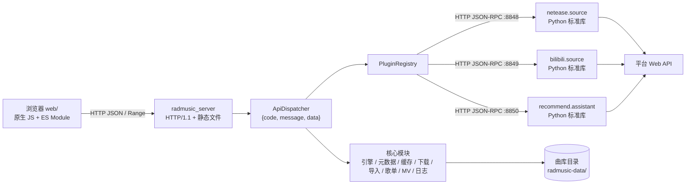

# Rad Music

> 自托管音乐库 · **C++17 后端（零第三方依赖）** + **Material Design 静态 Web UI** + **网易云 / 哔哩哔哩 / 智能推荐**音源插件

[中文](#中文) · [English](#english)

<p align="center">
  <a href="https://github.com/zbl201054/rad-music/releases"></a>
  <a href="https://github.com/zbl201054/rad-music/stargazers"></a>
  <a href="https://github.com/zbl201054/rad-music/network/members"></a>
  <a href="https://github.com/zbl201054/rad-music/releases"></a>
  <a href="https://github.com/zbl201054/rad-music/issues"></a>
  <a href="https://github.com/zbl201054/rad-music/blob/main/LICENSE"></a>
  <a href="https://github.com/zbl201054/rad-music"></a>
  <a href="https://github.com/zbl201054/rad-music/commits"></a>
  <a href="https://github.com/zbl201054/rad-music/actions/workflows/build.yml"></a>
</p>

## 仓库地址 / Repository

- **GitHub**：[https://github.com/zbl201054/rad-music](https://github.com/zbl201054/rad-music)
- **Gitee（码云）**：[https://gitee.com/bolin2010/rad-music](https://gitee.com/bolin2010/rad-music)

---

## 中文

一套可自托管的「本地 + 在线」音乐库：**C++17 后端（零第三方依赖）** + **无框架静态 Web UI** + **外部进程音源插件**。

后端负责曲目元数据、缓存、加载/播放状态、歌词、下载、导入、歌单/专辑/MV、日志与 HTTP API；前端是一个由后端直接托管的静态页面，用浏览器原生 `<audio>` 播放；在线音源通过「播放源插件」接入，仓库内已带网易云音乐、哔哩哔哩与智能推荐三个插件。

> 当前状态：接口标准 **API v0.11** 已实现，并包含 **v0.12** 的检查更新（GitHub / Gitee Releases 检查、任意版本选择性安装、下载、覆盖重启）增量；**应用发布版本**见上方 Release 徽章，开发 / 预览版本发布在 `dev` / `canary` 频道（见设置页「版本」）。接口定义见 [`api/Readme.md`](api/Readme.md)，实现说明见 [`api/IMPLEMENTATION.md`](api/IMPLEMENTATION.md)。

### 目录

- [功能特性](#功能特性)
- [架构](#架构)
- [目录结构](#目录结构)
- [快速开始](#快速开始)
- [插件机制](#插件机制)
- [HTTP API](#http-api)
- [数据目录](#数据目录)
- [测试](#测试)
- [已知限制](#已知限制)
- [常见问题](#常见问题)
- [文档](#文档)
- [规模](#规模)
- [许可证](#许可证)

### 功能特性

| 模块 | 能力 |
| --- | --- |
| 曲库 | 多音源曲目统一展示，同曲折叠；按音源、音质、标题/歌手/专辑/时长筛选与排序；一键播放全部 |
| 搜索 | 跨多个音源并发搜索，±3 秒时长容差折叠同一首歌；可按音源、最低音质、时长区间、仅可播放过滤，支持分页 |
| 播放 | 浏览器 HTML5 `<audio>` + HTTP Range（可拖动进度）；自动/手动选音质；播放队列、上一首/下一首、音量 |
| 歌词 | 标准/增强 LRC、翻译、罗马音三轨同步，播放页与播放条双处高亮；在线歌词可回退到插件 |
| 歌单 / 专辑 | 引用式存储（只存曲目引用，不复制音频），保序、幂等去重、原子写；支持批量加入与编辑 |
| MV | 与曲目同构的 `mv/<sha>/` 目录，`sha` 与 `(platform, item_id)` 双唯一，支持搜索与播放地址解析 |
| 下载 | 任务队列、同曲同质去重、校验后落盘 `tracks/` 并入索引（网络取流需宿主注入，见「已知限制」） |
| 导入 | 扫描本地音乐，解析 ID3v2 / FLAC / MP4 / APE / WAV / Ogg 标签与音频参数，失败回退文件名；冲突检测、dry-run 报告 |
| 缓存 | meta/audio/stream/lyric/cover/tmp 分层统计，分层限额、LRU 淘汰、按条目重建，清理不碰用户数据 |
| 调音 | 10 段 EQ、前置增益、预设保存；参数层已实现，音频处理链由宿主或音效插件接入 |
| 智能推荐 | 每日推荐、漫游（发现）、探索、相似歌曲、心情电台、推荐流、偏好与反馈（由 `recommend` 插件提供） |
| 系统集成 | SMTC 元数据/状态/时间轴上报接口；运行日志分级分类、文件轮转与内存环形缓冲 |
| 设置 | 6 套主题 × 深浅色、播放器圆角/紧凑模式、默认音质、折叠/隐藏不可用、插件启停、缓存、日志、API 文档 |
| 多语言 | 中文（简体/繁体）、英语（英国/美国）、中文（萌猫语）五套内置语言包，设置页一键切换；语言包是 `.rlan`（JSON：中文原文 → 译文），可导入导出、可继承、可用替换规则整句改造；未收录的文案自动回落中文 |
| 更新 | 设置页「版本」从 **GitHub / Gitee** 双源拉取版本号与发布历史（下载源可切换，仓库地址在页面最下方「仓库配置」里可改），支持 `release` / `dev` / `canary` 频道检查；**可选择任意版本安装**（含低于当前版本的降级回退、同版本重装）；多线程分段下载本平台安装包（线程数可调 1–16）。桌面端走 **安装包**（`*-win64-desktop-setup.exe`，静默安装后自动重启，外壳与服务端一起换），其余平台走归档解压覆盖；数据与设置不受影响 |

### 架构



三层职责：

1. **核心库**（`api/include/radmusic/`、`api/src/`）：纯 C++17，自带 JSON、SHA-256、MD5、HMAC、PBKDF2、Base64、AES-256-GCM，不链接任何第三方库。可直接链接进桌面播放器，也可经 HTTP 暴露。
2. **HTTP 服务端**（`api/tools/radmusic_server.cpp`）：把各模块接线为可执行程序，自带 WinSock/POSIX 传输层与静态文件服务，同时负责扫描、拉起并代理音源插件。
3. **Web UI**（`web/`）：无构建步骤、无框架。`app.js` 负责外壳/播放器/路由，`views.js` 负责页面，`settings.js` 负责设置，`api.js` 负责请求与格式化，`styles.css` 使用 MD3 变量。

### 目录结构

```text
Rad music/
├─ api/
│  ├─ Readme.md              # API 标准（数据模型、接口、错误码、插件标准）
│  ├─ IMPLEMENTATION.md      # C++ 实现说明（章节映射、测试、兼容性）
│  ├─ CMakeLists.txt         # CMake 构建（可选）
│  ├─ Makefile               # MSYS2/MinGW 便捷构建（Windows 实测）
│  ├─ include/radmusic/*.hpp # 头文件：错误码、JSON、加密、音质、模型、存储、插件、歌词、引擎…
│  ├─ src/*.cpp              # 对应实现
│  ├─ tests/                 # 零依赖测试框架 + 测试文件
│  ├─ tools/radmusic_server.cpp  # HTTP 服务端入口
│  ├─ build/                 # 构建产物（radmusic_server / radmusic_server.exe）
│  └─ radmusic-data/         # 开发用曲库数据（可换成任意目录）
├─ web/                      # 静态前端（index.html / app.js / views.js / settings.js / api.js / i18n.js / styles.css）
│  └─ langs/                 # 内置语言包 *.rlan（.rlan 就是 JSON，可直接编辑）
├─ desktop/                  # 桌面端原生窗口壳（Win32 + WebView2，复用 web/ 与服务端）
├─ android/                  # 安卓端（WebView 壳 + NDK 交叉编译的 arm64 服务端 → APK）
├─ tools/i18n/               # 语言包维护脚本：抽词表 → 填译文 → 编译 .rlan
└─ plugins/
   ├─ netease/               # 网易云音乐播放源插件（main.py + plugin.json + README.md）
   ├─ bilibili/              # 哔哩哔哩播放源插件（main.py + plugin.json + README.md）
   └─ recommend/             # 智能推荐插件（每日推荐 / 漫游 / 相似 / 心情电台，main.py + plugin.json + README.md）
```

### 快速开始

#### 依赖

- **编译器**：支持 C++17 的 g++ / clang++ / MSVC（Windows 上推荐 MSYS2 MinGW-w64，实测 g++ 16.1.0）
- **构建工具**：`mingw32-make`（Windows）或 `make`；也可用 CMake ≥ 3.16
- **Python 3**：仅音源插件需要，且只用标准库（网易云默认端口 8848，B 站 8849，智能推荐 8850）
- 可选：`curl` 用于命令行调试接口

> 不想自己编译？从 [Releases](https://github.com/zbl201054/rad-music/releases) 下载对应平台的预编译包（Windows x64 / Linux x86_64 / macOS arm64 + x86_64），解压即用。

#### 编译

```bash
cd api

# 方式一：Makefile（Windows / MSYS2）
mingw32-make server     # 只编译服务端
mingw32-make            # 服务端 + 测试

# 方式二：CMake
cmake -S . -B build-cmake && cmake --build build-cmake
```

Windows 上 HTTP 传输层需要链接 `ws2_32`，Makefile 与 CMakeLists 已处理。改过 `.hpp` 后若出现随机崩溃，请先 `mingw32-make clean`（旧的 `.o` 与新的类布局混链会导致堆损坏）。

#### 运行

```bash
# 在仓库根目录
api/build/radmusic_server --root api/radmusic-data --web web --port 8765
```

```bash
# Windows 路径写法
api\build\radmusic_server.exe --root api\radmusic-data --web web --port 8765
```

打开 <http://127.0.0.1:8765/> 即可使用。`--web` 省略时会在 `web`、`../web`、`../../web` 中自动探测含 `index.html` 的目录。

#### 独立程序（不依赖浏览器）

仓库里还带了两端的「不依赖浏览器」外壳，服务端与前端完全复用上面这套，没有第二套 UI：

| 端 | 构建 | 产物 | 说明 |
| --- | --- | --- | --- |
| 桌面（Windows） | `desktop/build_desktop.sh` | `dist/desktop/radmusic_desktop.exe` | Win32 + WebView2 原生窗口。双击即用：自动拉起同目录的 `radmusic_server.exe`、等端口就绪后用内嵌内核打开界面；关窗时通过 `POST /music/shutdown` 优雅关闭自己拉起的服务；重复双击只激活已有窗口；若 8765 已有服务在跑则直接复用、退出时不动它。外壳本体约 1 MB |
| 安卓 | `android/build_apk.sh` | `dist/android/radmusic-<版本>-arm64.apk` | 独立 APK，约 3.4 MB。C++ 服务端用 NDK 交叉编译成 arm64 可执行文件随包分发，WebView 加载 `127.0.0.1:8765`。**一体两用**：本机播放手机里的音乐，或连接局域网里电脑上的 Rad Music 使用全部在线音源。详见 [`android/README.md`](android/README.md) |

> 改 `web/` 或 `api/` 之后，两端重新打包即同步；两端都不改后端接口与目录结构。
> 安卓的本机模式没有在线音源，原因是音源插件是 Python 进程，Android 上无法运行（唯一硬限制）。

没有音源、只想看界面和链路是否正常：

```bash
api/build/radmusic_server --demo --root api/radmusic-data --web web
```

`--demo` 注册一个内置演示播放源（合成曲目、无网络依赖），可用于联调搜索、折叠、音质与歌词。

> **关于插件目录**：从仓库根目录运行时，服务端会自动扫描 `plugins/`（以及向上两级的 `plugins`）与 `<root>/plugins/` 下的 `plugin.json`，无需额外参数。若把可执行文件复制到其它目录（例如本地盘的 `%LOCALAPPDATA%\RadMusic\`）再运行，自动扫描会失效，此时必须用 `--plugin-dir` 显式指向插件目录：`--plugin-dir "G:\Rad music\plugins"`（路径按你的实际位置填写）。

#### 接入音源

1. 启动服务后，服务端会扫描 `plugins/*/plugin.json`，并按清单里的 `command` 自动拉起插件（需要 `python` 在 `PATH` 中，可用 `--no-plugin-autostart` 关闭）。
2. 在「设置 → 音源」查看各音源是否就绪，点「刷新音源信息」重新探活。
3. 网易云登录（可选，用于提升音质与解锁 VIP 曲目）：浏览器打开 <http://127.0.0.1:8848/login>，用手机 App 扫码确认，凭据会写入 `plugins/netease/cookie.txt`。
4. 回到「搜索」页输入关键词即可跨源搜索；本地文件走「导入」页扫描入库。

#### 命令行参数

| 参数 | 默认值 | 说明 |
| --- | --- | --- |
| `--root <dir>` | `radmusic-data` | 曲库根目录（数据、缓存、日志、插件清单都在这里） |
| `--host <ip>` | `127.0.0.1` | 监听地址；没有鉴权，不要直接绑 `0.0.0.0` |
| `--port <n>` | `8765` | HTTP 端口，同时提供页面与 API |
| `--web <dir>` | 自动探测 | 静态页面目录 |
| `--demo` | 关 | 注册内置演示播放源 |
| `--plugin-dir <dir>` | — | 额外的插件目录，可重复（异地运行时必须显式指定） |
| `--no-plugin-autostart` | 关 | 不自动拉起插件进程 |
| `--io-timeout <ms>` | `5000` | 连接读写超时 |
| `--log-level <lvl>` | `info` | `trace/debug/info/warn/error/off` |
| `--log-file <path>` | `<root>/logs/radmusic.log` | 日志文件（8 MiB 轮转） |
| `--no-log-console` | 关 | 不向控制台输出日志 |

### HTTP API

所有业务接口返回统一结构，HTTP 状态码只表示传输层结果：

```json
{ "code": 0, "message": "ok", "data": {} }
```

`code = 0` 成功；`1001–1032` 为业务错误（平台错误、base 冲突、音质未定义、歌单不存在等），完整列表见 [`api/Readme.md` 第 3 节](api/Readme.md#3-错误码补充)。

| 接口组 | 方法与路径 | 说明 |
| --- | --- | --- |
| 加载 | `POST /music/load` | 按 `sha` / `platform+id` 加载曲目；`base.json` 缺失先重建，`secret=1` 走解密 |
| 播放 | `POST /music/start\|pause\|resume\|stop\|seek`、`GET /music/status` | 播放控制与状态机 |
| 音频流 | `GET /music/audio/{sha}` | 发送音频文件，支持 `Range`（206） |
| 元数据 | `GET /music/info`、`POST /music/verify` | 当前曲目元数据 / 校验解密口令 |
| 曲库 | `GET /music/library` | 列出已入库曲目（可按 `platform` 过滤） |
| 曲库 | `DELETE /music/library/{sha}` | 从曲库移除：`delete_file=false` 只删记录（默认 `true`，连带删除 `tracks/<sha>/` 下的音频）；`all=true` 连同同一首歌的其它音质版本；歌单 / 专辑引用与失效的下载任务一并清理 |
| 搜索 | `GET\|POST /music/search` | 多源聚合搜索、折叠、筛选、分页 |
| 多源请求 | `POST /music/request` | 统一路由到具备对应能力的播放源插件 |
| 歌词 | `GET /music/lyric` | 归一化歌词（原文/翻译/罗马音） |
| 音质 | `GET /music/quality` | 各音源声明的音质定义与曲目可用音质 |
| 缓存 | `GET\|POST /music/cache*` | 统计、清理、重建、限额配置 |
| 下载 | `POST\|GET\|DELETE /music/download` | 任务创建/查询/暂停/取消 |
| 打开所在文件夹 | `POST /music/open-folder`（别名 `POST /music/download/{id}/open-folder`） | 在系统文件管理器中定位文件：body 三选一 `task_id` / `sha` / `path`，都不给则打开曲库 `tracks/` 目录 |
| 导入 | `POST\|GET /music/import*` | 扫描、开始、状态、取消、冲突报告 |
| 调音 | `GET\|POST /music/eq`、`/music/dsp/*` | EQ 参数与预设 |
| 歌单 | `GET\|POST /music/playlist*` | 列表、创建、增删曲目、批量加入 |
| 专辑 | `GET\|POST /music/album*` | 同上，另有从曲库批量选取与元信息编辑 |
| MV | `GET\|POST /music/mv*` | 搜索、详情、加入与播放地址 |
| 日志 | `GET /music/logs`、`POST /music/logs/level` | 读取内存日志、运行时改级别 |
| 插件 | `GET\|POST /music/plugins*` | 列出、注册、启停插件 |
| 推荐 | `GET\|POST /music/recommend*` | 每日推荐 / 漫游 / 相似 / 心情电台 / 偏好与反馈（由 `recommend` 插件提供） |
| 设置 | `GET\|POST /music/settings` | 读写 `settings.json` |
| 数据 | `GET /music/data`、`POST /music/data/purge` | 按分类统计占用 / 清除全部数据（需 `confirm: "PURGE"`） |
| 检查更新 | `GET /music/update`、`POST /music/update/{check\|select\|download\|apply}` | 从 GitHub 或 Gitee 拉取版本信息与发布历史、按频道（`release`/`dev`/`canary`）比对版本、**指定任意版本安装（可降级回退）**、分片下载本平台安装包、解压覆盖并重启（需 `confirm: "UPDATE"`）；下载支持多线程（`threads` 1–16）；返回里的 `mode` 说明由谁执行更新（`self` 服务端自更新 / `external` 壳程序负责 / `manual` 只能手动下载）；详见 [`api/Readme.md` 2.20](api/Readme.md) |
| 多语言 | `GET /music/langs`、`GET /music/langs/content?id=`、`POST /music/langs/import`、`POST /music/langs/remove` | 列出 / 读取 / 导入 / 删除数据目录 `langs/` 下的 `.rlan` 语言包（内置包是 `web/langs/` 静态文件，同名时以导入的为准）；导入 body 为 `{filename, pack}`，`pack` 就是 `.rlan` 的 JSON 内容 |
| 分享 / 导出 | `GET /music/share/playlist`、`POST /music/share/export`、`POST /music/share/import`、`GET /music/share/download` | 歌单分享（`.rdl`，JSON）与曲库导出（常规音频文件 / `.rdm` 音频包，zip 封装 `base.json` + 音频 + 封面），并支持这两种文件的导入；详见 [`api/Readme.md` 2.22](api/Readme.md) |

示例：

```bash
curl http://127.0.0.1:8765/music/status

curl -X POST http://127.0.0.1:8765/music/search \
     -H "Content-Type: application/json" \
     --data-binary '{"keyword":"海阔天空"}'
```

> Windows 的 `curl.exe -d '{...}'` 容易被 shell 吞掉引号，建议把 JSON 写进文件后用 `--data-binary @body.json`。

### 各客户端怎么更新

同一份前端跑在三种壳里，`GET /music/update` 返回的 `mode` 字段说明「谁来执行更新」：

| 客户端 | `mode` | 检查 / 下载 / 安装 |
| --- | --- | --- |
| 桌面壳（`radmusic_desktop.exe`） | `self` | 服务端自己查 Releases、分片下载 **安装包**（`-win64-desktop-setup.exe`），由 `updates/apply_update.ps1` 等旧进程退出后静默安装并重新拉起程序（`/VERYSILENT /DIR=<安装目录>`）；没装完下次启动会自动续装，最多 2 次。安装目录里有 `radmusic_desktop.exe` 才算桌面端，否则吃 web 版归档 |
| Windows/Linux/macOS 的 `radmusic_server`、浏览器直连本机服务 | `self` | 同上但吃归档（`-win64.zip` / `-linux-x86_64.tar.gz` / `-macos-*.tar.gz`）：解压后逐个文件覆盖并重启 |
| 安卓（APK） | `external` | 服务端没有 `UpdateService`（进程换不掉自己的安装包），只回状态；检查与下载由壳程序完成（`UpdateClient`），下载走系统 `DownloadManager`，装包交系统安装器（需授予「安装未知应用」） |
| 其它宿主（例如手机浏览器直连电脑上的服务） | `manual` | 只显示当前版本与发布页链接，安装包手动下载 |

没装配更新服务的宿主，`GET /music/update` 现在仍返回 200 和完整结构（`supported: false`、`state: "unsupported"`、`mode`），页面据此渲染「由应用自己更新 / 请到发布页手动下载」，而不是停在空白页、点按钮才报错。

### 数据目录

```text
<root>/
├─ tracks/<sha>/            # 已入库音频（持久），sec.json / lyric.lrc 也在这里
├─ tracks/.staging/         # 原子提交暂存
├─ covers/<hash>.<ext>      # 封面存档
├─ index/index.json         # 库索引（唯一键 → 路径，与磁盘不一致时以磁盘为准）
├─ library/                 # 用户数据：playlists/<id>.json、albums/<id>.json
├─ mv/<sha>/mv.json         # MV
├─ presets/eq/              # EQ 预设
├─ logs/radmusic.log        # 运行日志（+ .1 轮转）
├─ settings.json            # 主题、音量、默认音质、插件开关等
├─ plugins/<id>/plugin.json # 通过设置页注册的插件清单
└─ cache/                   # 可随时清理
   ├─ meta/<song_key>/<quality_key>/base.json   # 元数据：一首歌一个文件夹、每个音质一个文件夹
   ├─ audio/ stream/ lyric/ cover/ tmp/
```

关键设计：

- **`base.json` 放在缓存里，不在音频目录**。路径本身即唯一键：`song_key`（歌曲）+ `quality_key`（音源+音质），不同音质天然落在不同目录，结构上不可能互相覆写。
- **写入前读-比较-再写**：内容相同 → `skipped`，可补全字段 → `merged`，同曲同质但内容不同 → `1023 base conflict` 且默认拒绝覆写；提交时先写同目录 `.tmp` 再同卷原子替换。
- **缓存可清理，用户数据不可清理**：`tracks/`、`library/`、`mv/`、`presets/`、`logs/` 不会被 `cache clear` 或 LRU 淘汰删除；`base.json` 可由索引 + 音频/在线源重建到同一路径。

### 多语言

界面文案全部以**中文原文为键**，语言包只提供「中文原文 → 译文」的映射；代码里不用写任何 `t('key')`
调用，渲染出来的中文会被一个 DOM 翻译层（`web/i18n.js`）按文本节点替换，切语言就是把整棵树重翻一遍。
好处是不管文案写在哪个文件、是模板拼出来的还是 `innerHTML` 生成的都能翻；代价是同一个中文词只能对应一个译文
（比如「播放」既是按钮也是标签页，所以标签页改叫「播放体验」）。

内置语言：中文（简体，即界面原文）、中文（繁體，opencc 由简体自动转换）、英语（美国）、英语（英国，继承美式只覆盖拼写）、
中文（萌猫语，靠替换规则逐句改造，连以后新加的文案也会被猫化）。

`.rlan` 就是一个 JSON 文件：

```json
{
  "format": "rlan",
  "format_version": 1,
  "id": "en-US",
  "name": "英语（美国）",
  "native_name": "English (United States)",
  "locale": "en-US",
  "author": "Rad Music",
  "version": "1.0.0",
  "inherit": "",
  "direction": "ltr",
  "strings": { "设置": "Settings", "曲库": "Library" },
  "patterns": [["已加入歌单（共 {0} 首）", "Added to playlist ({0} tracks)"]],
  "rules": [],
  "rules_fallback": false
}
```

| 字段 | 说明 |
| --- | --- |
| `strings` | 精确词条，`中文原文` → `译文`；查不到就回落中文，绝不显示 key |
| `patterns` | 带变量的句子。`{0}` / `{1}` 是通配捕获组，译文里用同名占位符回填；`{^0}` 表示「捕获到的内容也是界面词，一并翻译」（只给确定不是用户数据的场景用） |
| `rules` + `rules_fallback` | 逐条替换规则，做「萌猫语」这类整句改造的语言；单遍扫描、长规则优先，不会叠加重复替换 |
| `inherit` | 继承另一个语言包，只写差异（`en-GB` 就继承了 `en-US`） |

- 内置包放在 `web/langs/*.rlan`，随客户端一起发布；导入的包落到数据目录 `langs/`，两者同名时以导入的为准（官方包可以不发版就更新）。
- 设置页「语言」里可以切换、导入、导出、删除；切换会写进 `settings.json`（`language`）并同步到其它设备。
- 维护流程：`python tools/i18n/extract.py --json tools/i18n/strings.json` 抽出界面文案 → 在 `tools/i18n/en*.json` 补译文 → `python tools/i18n/build_packs.py` 重新编译五套包（繁中用 opencc 自动转换，萌猫语用 `moe_rules.json`）。
- 未加载语言包（`zh-CN`）时翻译层完全关闭，DOM 一个字节都不碰，行为和加多语言之前完全一致。

### 插件机制

播放源插件是**独立进程**，通过本地 HTTP JSON-RPC 与宿主通信；`plugin.json` 声明平台、能力、音质与启动命令。**仓库内每个插件占 `plugins/` 下的一个子目录**（`plugin.json` + `main.py` + `README.md`），当前全部为 `type: "source"`。

```json
{
  "id": "netease.source",
  "name": "网易云音乐",
  "type": "source",
  "platforms": ["netease"],
  "api_version": "1",
  "entry": "main.py",
  "transport": "http",
  "endpoint": "http://127.0.0.1:8848",
  "command": ["python", "main.py", "--port", "8848"],
  "capabilities": ["search", "get_song", "get_url", "get_qualities", "get_lyric", "get_pic"]
}
```

- 插件只需实现 `GET /health`、`POST /request`（`{"op": "...", "params": {...}}`），可选 `GET /login` 提供登录页。
- 宿主按 `capabilities` 路由 `request`，未声明的 op 返回 `1012`；音质等级由插件声明，宿主只做归一化比较，不编造平台音质。
- 宿主会扫描插件目录下**每个子目录的 `plugin.json`**（`transport` 必须是 `http` 且有 `endpoint`），清单校验失败则跳过并记日志。
- 新增音源 = 在 `plugins/` 下加一个目录 + `plugin.json` + 实现，无需改动后端。

**已内置的三个插件：**

| 插件 | 端口 | 平台 | 类型 | 主要能力 |
| --- | --- | --- | --- | --- |
| `netease.source`（网易云音乐） | 8848 | netease | source | 搜索/歌曲/播放地址/音质/歌词/封面/歌单/专辑/歌手/MV/登录 |
| `bilibili.source`（哔哩哔哩） | 8849 | bilibili | source | 搜索/歌曲/播放地址/音质/歌词/封面/歌单/MV/登录 |
| `recommend.assistant`（智能推荐） | 8850 | recommend | source | 每日推荐/漫游/探索/相似/心情电台/推荐流/偏好/反馈 |

> 仓库早期文档曾建议按 `plugins/source/`、`plugins/function/` 分层摆放，但该约定从未在代码中落地，实际始终为扁平目录。本文档以当前代码结构为准。

### 测试

```bash
cd api
mingw32-make test                 # 编译并运行全部用例
mingw32-make test FILTER=storage  # 只跑名字含 storage 的用例
build/radmusic_tests -v           # 列出每个用例名（Windows 为 radmusic_tests.exe）
```

覆盖 JSON、加密原语（已知答案向量）、存储防覆写与原子写、歌词三轨、搜索折叠、标签解析、引擎状态机、缓存策略、下载、导入、API 路由与错误码、HTTP 传输层、日志、歌单/专辑/MV。当前结果（`g++ 16.1`，`-Wall -Wextra` 零警告）：

```text
合计: 167 个用例, 通过 167, 失败 0
```

### 已知限制

1. **单用户、无鉴权**：默认只监听 `127.0.0.1`。对外提供服务请放在反向代理后并自行加认证。
2. **传输层保持极简**：每个连接只服务一次请求（固定 `Connection: close`），不支持 chunked（411），不做 TLS。
3. **结构播放与 SMTC 是接口**：C++ 引擎维护加载/播放状态机，实际解码在浏览器；`SmtcSink` 需桌面端用 WinRT 实现后注入。
4. **在线下载需要宿主注入取流器**：下载队列、校验、落盘、索引都已实现，但内置 `default_fetch` 只支持本地与 `file://`；`http(s)` 需注入 `fetch` 才能真正下载网络音频。
5. **调音只有参数层**：EQ 参数、预设与持久化已实现，真正的滤波/限幅处理链需要宿主或音效插件提供。
6. **依赖平台账号与版权**：部分音质、VIP 曲目、MV 需要登录；接口与音质会随平台策略变化。
7. **插件依赖 Python 3**：未安装 Python 或插件进程未启动时，对应音源在设置页显示未就绪，搜索会跳过该源（不会导致整体失败）。
8. **桌面端用安装包更新，安装程序本身未签名**：应用内更新下载的是 `-win64-desktop-setup.exe`，静默安装后自动重启，外壳与服务端一起换（旧的免安装版可以手动下载该安装包、把安装目录选成原目录来原地升级）。安装包未签名，安全软件可能拦一次；另外**别把安装包放在带「低完整性（Low）」标记的目录里**（某些沙箱 / 受保护目录会给里面新建的文件套上这个标签，Windows 随后会把进程一起降权，连 `%TEMP%` 都写不了，表现为 `Setup was unable to create the directory …\is-XXXX.tmp，Error 5: 拒绝访问`、或静默 exit 4 且没有任何日志）。这两种情况客户端都有兜底：下次启动读到安装程序退出码非 0 就自动切到「免安装包覆盖」并提示一句，重新「检查更新 → 下载」即可继续。想用安装包本身（含快捷方式/卸载项），把 setup.exe 复制到桌面（或 `icacls <文件> /setintegritylevel Medium`）再双击即可；长期正解是给安装包做代码签名。安卓仍然由应用自己下载、安装必须经用户确认系统安装器。

### 常见问题

**`radmusic_server` 双击或从命令行启动后没有任何输出？**
项目放在 `G:` 等受限/网络盘符时可能直接退出。把可执行文件复制到本地盘（例如 `%LOCALAPPDATA%\RadMusic\`）再运行，并用 `--root`、`--web`、`--plugin-dir` 指向原来的数据与页面目录。

**端口被占用？**
换 `--port 8766`；同时注意插件端口（8848 / 8849 / 8850）不要与其他程序冲突。

**页面能打开但没有声音 / 无法拖动进度？**
音频由 `GET /music/audio/{sha}` 提供，必须支持 `Range`。确认曲目已在 `tracks/` 落盘（未下载的在线曲目需要先取到播放地址）。

**「音源未就绪」？**
确认 `python --version` 可用；手动跑 `python plugins/netease/main.py --port 8848` 看报错，或访问 `http://127.0.0.1:8848/health`。也可以在设置页关闭自动拉起后自行管理进程。

**桌面程序被 360 / 火绒拦截或删除？**
`radmusic_desktop.exe` / `radmusic_server.exe` 是新编译的未签名程序，部分安全软件会当成可疑文件。
在安全软件里把整个程序目录加入信任列表（或对弹窗选「允许」）即可；这不影响程序本身。
另外 WebView2 报 `0x800700AA` 时，多半是上一次的浏览器进程还没退干净 —— 新版会自动重试并换备用数据目录，
实在不行结束任务管理器里残留的 `msedgewebview2.exe`、或重启电脑后重试。

**改了前端没生效？**
前端是纯静态文件，刷新浏览器即可（静态响应带 `Cache-Control: no-cache`）。改了后端必须重新编译并重启进程。

**清理缓存会删掉我的歌吗？**
不会。清理只作用于 `cache/`；`tracks/`、`library/`、`mv/`、`presets/`、`logs/` 属于持久数据。

### 文档

| 文档 | 内容 |
| --- | --- |
| [`api/Readme.md`](api/Readme.md) | API 标准：`base.json` 与音质定义、加载/解密/歌词/SMTC/调音/下载/缓存/导入、接口定义、错误码、目录约定、插件标准、版本兼容 |
| [`api/IMPLEMENTATION.md`](api/IMPLEMENTATION.md) | C++ 实现说明：构建与测试、章节 → 代码映射、不可覆写保证、未实现项、版本兼容性 |
| [`plugins/netease/README.md`](plugins/netease/README.md) | 网易云插件：登录、op 列表、音质、风控与降级 |
| [`plugins/bilibili/README.md`](plugins/bilibili/README.md) | 哔哩哔哩插件：搜索、播放地址、MV、登录 |
| [`plugins/recommend/README.md`](plugins/recommend/README.md) | 智能推荐插件：每日推荐、漫游、相似、心情电台、偏好与反馈 |

### 规模

约 **4.5 万行**代码（C++ 核心与测试约 3.3 万行、`web/` 前端约 0.7 万行、`plugins/` 三个 Python 插件约 0.6 万行），无第三方运行时依赖。

### 许可证

本项目采用 **MIT 许可证**。你可以在遵守许可证条款的前提下自由使用、修改、分发本软件。许可证全文见仓库根目录的 [`LICENSE`](LICENSE) 文件。

## 更新日志

### v0.15.1（`release` 频道 / latest，正式稳定版）

这一版把上一轮预览改动转为正式版：修掉「安卓端插件整体不可用」，并把更新流程按客户端拆开，服务端不再假装自己能更新一切。

- **安卓插件修好了**（三个都是真 bug）：
  - 「智能推荐」的 `plugin.json` 写成了 `"platforms": []`，而播放源插件必须声明平台，于是整条清单在加载时被校验拒收——发现页永远显示「推荐插件未连接」。现已改为 `["recommend"]`。
  - 插件清单只在 `web/` 版本号变化时才跟着重同步：前端没变、只改了 `plugin.json` 的升级，装完以后插件目录还是空的/旧的。现在前端包和插件清单各用一份内容摘要（`.web_version` / `.manifests_version`）独立比对，清单变了就一定重写，并顺手删掉已经不存在于 APK 里的插件目录。
  - 安卓侧的清单能力声明远少于 Java 实现：网易云只声明 7 个能力（实际可用 18 个）、哔哩哔哩 7 个（实际 17 个）。宿主按声明的能力路由，没声明的直接回 `1012 未声明 op`——歌单、专辑、歌手、MV、登录、设置这些功能在手机上点一下就是报错。现已按实现补齐；扫码 / 手机号登录仍未实现，因此**不**声明这三个 op（继续用 Cookie 登录）。
- **音频代理不再整个缓冲**：`/media` 转发 MV / 无损时，原来把上游响应整段读进 `ByteArrayOutputStream` 再写回，几百 MB 直接顶到手机内存上限。现在先写响应头（含 `Content-Range`）再用 64 KiB 缓冲流式转发，上游 4xx/5xx 回 502。
- **更新流程按客户端分三种形态**：`GET /music/update` 新增 `supported` / `mode` 两个字段（`self` / `external` / `manual`）。桌面端仍是原来的自更新；安卓是 `external`——服务端不装配 `UpdateService`，只回状态与版本信息，检查/下载/安装由壳程序负责；没有壳的宿主是 `manual`。没装配更新服务时不再返回 `1011` 让页面空白，而是 200 + `state: "unsupported"`。
- **安卓终于有应用内更新**：新增 `UpdateClient`（查 GitHub / Gitee Releases、按频道过滤、挑 `android-arm64.apk`、版本比较与服务端同语义），壳程序用系统 `DownloadManager` 下载，再经 `getUriForDownloadedFile` 交给系统安装器（不需要 FileProvider）；「设置 → 版本」在 `mode: external` 时换成「检查新版本 / 下载并安装 / 继续安装」按钮，并保留频道与下载源切换，进度与结果由壳回调 `window.RadMusicUpdate`。
- **安卓版本号可比较了**：`versionCode` 之前恒为 1，系统与任何工具都无法判断新旧。现在 `build_apk.sh` 按 `主*10000000 + 次*100000 + 修订*1000 + 通道位*10 + 预发布序号` 计算并注入（同时写进 `BuildConfigVersion.CODE` 和清单），`aapt2 link` 也带上 `--version-code`；新增 `REQUEST_INSTALL_PACKAGES` 权限。
- **客户端改用安装包更新（Windows 桌面端）**：以前桌面端拿的是 web 版归档 `-win64.zip`，里面没有 `radmusic_desktop.exe`——「更新」只换了服务端和前端，外壳永远升不上去。现在：
  - 发版多带一个 Inno Setup 安装包 `rad-music-v<版本>-win64-desktop-setup.exe`（`desktop/installer/radmusic.iss`，由 `desktop/build_installer.sh` 编译，CI 的 `desktop-win` job 负责装 Inno Setup 并校验产物存在）。
  - 挑包逻辑按安装目录判断形态：目录里有 `radmusic_desktop.exe` 就优先安装包，其次是旧的 `-win64-desktop.zip`，**绝不**退到 web 版归档；纯服务端仍吃 `-win64.zip`。`GET /music/update` 新增 `package`（`installer` / `archive`）与 `desktop_bundle` 两个字段，界面据此把按钮文案换成「下载安装包 / 安装并重启」。
  - 应用时不再解压：写 `updates/apply_update.ps1` 等旧进程退出，再以 `/VERYSILENT /SUPPRESSMSGBOXES /NORESTART /CLOSEAPPLICATIONS /DIR=<安装目录>` 静默跑安装程序，装完由安装包的 `[Run]` 项重新拉起程序。安装包装到 `%LOCALAPPDATA%\Programs\RadMusic`（按用户、免 UAC），曲库 `radmusic-data` 就在旁边；卸载时问一句要不要连曲库一起删。
  - `updates/apply.pending` 现在记 `mode` 与安装包路径，续装直接重跑安装包（最多 2 次），超过后提示里直接给出安装包路径。
  - **安装包被安全软件拦下时自动降级**：安装脚本把安装程序的退出码写进 `updates/apply.last_result`；下次启动读到 `mode=installer` 且退出码非 0 就不再重试，而是清掉标记、把本次会话切成「免安装包覆盖」（`pick_release_asset(..., prefer_archive=true)`，挑包里 zip 排到安装包前面），状态里给出 `installer_blocked` 与一句人话提示。覆盖文件不会被拦，所以 360 环境下仍然能升上去。
  - 桌面壳新增服务端看门狗：自己拉起的服务端退出后，若存在未完成的更新标记就立刻跟着退出（否则窗口一直开着、exe 一直被锁，安装程序没法替换）；不是更新的退出则给新进程 3 秒，端口没回来才退。
- **退出程序时插件同步关闭**：插件是宿主用 `DETACHED_PROCESS` 拉起的独立进程，以前程序退出后它们继续挂在后台占内存、占端口（8848/8849/8850），下次启动还得靠 ping 认领回来。现在：
  - 宿主记账两类插件：自己拉起的（保留进程句柄，退出时 `TerminateProcess` 兜底）和启动时 ping 到并认领的（`remember_adopted_plugin`）。
  - 退出路径（`/music/shutdown`、更新安装）统一调 `shutdown_plugin_processes()`：先给认领来的插件发 `POST /shutdown`，再给子进程 1.5 秒自然退出、超时强杀。**纯重启（数据迁移 / 设置页重启）不关插件**——新实例会认领它们，关了反而让新实例面对一个死掉的 endpoint。
  - 三个 Python 插件（netease / bilibili / recommend）都加了 `POST /shutdown`：回 200 后在后台线程调 `server.shutdown()` 正常收尾。
- **发布包补上两个插件**：`plugins/recommend`（智能推荐）与 `plugins/equalizer`（调音面板）以前只在本地 `build_desktop.sh` 里被收进目录，打包脚本 `package.sh` / `package_desktop_win.sh` 却只点名了 netease、bilibili —— 结果发行版里「歌曲推荐」和「调音面板」都是空入口。现在三个打包脚本统一按白名单（`main.py` / `plugin.json` / `README.md` / `preferences.json` / `panel.html`）收全部四个插件。
- **插件登录 / 设置页不再另开系统浏览器窗口**：以前点「打开登录页」是 `window.open(..., '_blank')`，桌面壳没人处理 `NewWindowRequested`，WebView2 就把它丢给默认浏览器 —— 关掉 Rad Music 之后浏览器里还留着一个插件窗口，而背后的插件进程已经跟着程序退出了，只剩一张死页面。现在：
  - 前端改成**应用内弹窗 + iframe**（`openPluginPage()`），关弹窗或关程序一起消失；插件页面里留了「在浏览器中打开」当退路（万一某天插件加了 `X-Frame-Options`）。实测网易云 `/login` 没有 `X-Frame-Options` / CSP，可以正常嵌。
  - 桌面壳补了 `NewWindowRequested` 处理器：凡是 `127.0.0.1` / `localhost` 的新窗口一律拦下并写日志，防止任何漏网的 `window.open` 再往系统浏览器甩窗口；外部链接（发布页等）仍然交给默认浏览器。
- **安装包支持中英双语、安装位置可改**：安装向导开头是「选择安装语言」（简体中文 / English，静默安装不弹、按系统语言自动匹配），界面与提示、桌面快捷方式任务、卸载时的「是否删曲库」提问都跟着切换。默认安装位置改用 `{autopf}\RadMusic` —— 普通权限下还是 `%LOCALAPPDATA%\Programs\RadMusic`，选「为所有用户安装」时自动变成 `Program Files`；**目录页始终显示**（`DisableDirPage=no`），可以装到任意盘任意目录，客户端自更新会沿用 `install_dir` 不变。中文语言文件取自 Inno Setup 6.7.4 官方仓库的 `Files/Languages/Unofficial/ChineseSimplified.isl`，放在 `desktop/installer/` 里随仓库走（Inno 6 本体不自带中文）。
- **多语言**：新增 `web/i18n.js` 与 `.rlan` 语言包机制，内置中文（简体 / 繁体）、英语（英国 / 美国）、中文（萌猫语）五套。
  - 界面文案以**中文原文为键**，靠 DOM 翻译层按文本节点替换，代码里不用写 `t('key')`；切语言整棵树重翻一遍并重渲染当前页（音质标签这类代码拼出来的文案也能跟着变）。
  - 语言包是 JSON，支持 `strings`（精确词条）、`patterns`（带 `{0}` 的句子）、`rules` + `rules_fallback`（逐句替换，萌猫语用）、`inherit`（继承只写差异，`en-GB` 继承 `en-US`）。
  - 设置页新增「语言」标签页：切换 / 导入（`.rlan`）/ 导出 / 删除；当前语言写进 `settings.json` 的 `language`，跨设备同步，另外在本机 `localStorage` 存一份词表缓存，刷新时不会先闪一帧中文。
  - 后端新增 `GET /music/langs`、`GET /music/langs/content?id=`、`POST /music/langs/import`、`POST /music/langs/remove`，导入的包落在数据目录 `langs/`；静态服务放行 `/langs/<name>.rlan` 一级子目录。
  - 繁中由 opencc（`s2twp`）从简体自动转换，萌猫语靠 70 条替换规则（单遍扫描、长规则优先），两者都随词表更新而重新生成。
  - 维护脚本在 `tools/i18n/`：`extract.py` 抽界面文案（自动合并相邻字面量、剥 HTML）、`build_packs.py` 编译五套包；未收录的句子回落中文，并支持按句兜底翻译。
- **版本号**：回落值统一为 `0.15.1`（`version.hpp` / `Makefile` / `CMakeLists.txt` / 安卓 `BuildConfigVersion`；发布流水线仍以 tag 为准）。

> 应用内「设置 → 版本」保持默认 `release` 频道即可收到这一版；GitHub 网络不通时可把下载源切到 **Gitee**。本发版不含用户曲库与 cookie。

### v0.14.1-dev.1（`dev` 频道 / prerelease）

本轮把「不依赖浏览器」的两端正式纳入发布：桌面端与安卓端的安装包从这一版起随 Release 一起提供。

- **桌面端（Windows）**：`rad-music-v0.14.1-dev.1-win64-desktop.zip` —— Win32 + WebView2 原生窗口壳，解压后双击 `radmusic_desktop.exe` 即用，不再需要手动开浏览器。壳会自动拉起同目录的 `radmusic_server.exe`、等端口就绪后打开界面；关窗时通过 `POST /music/shutdown` 优雅退出自己拉起的服务；重复双击只激活已有窗口；若 8765 上已有别的实例在跑则直接复用、退出时不动它。
- **安卓端**：`rad-music-v0.14.1-dev.1-android-arm64.apk` —— WebView 壳 + NDK 交叉编译的 arm64 服务端，一体两用：本机播放手机里的音乐，或填电脑的地址使用全部在线音源。安卓侧不装配 `UpdateService`（APK 更新交给系统安装器），默认数据根改由壳程序用 `--root` 显式传入，也不再尝试往只读的 `nativeLibraryDir` 写 `data_root.txt`。
- **服务端支持 `HEAD` 请求**：此前 `HEAD` 会掉进 JSON 路由，回一句「未知接口」，`<video>` / `` 的探测、代理和下载工具因此把媒体地址判成坏资源。现在 `HEAD` 与 `GET` 走同一套路由，只保留响应头（`Content-Length` 仍是真实长度），body 在发送时截掉。
- **启动不再被插件拖住**：外部插件（Python 进程）的探活与拉起从 `server.start()` 之前挪到之后——原来每个起不来的插件要等好几秒，桌面壳和手机端会误判成「服务端启动失败」。现在先绑端口、界面可用，再补插件；探活超时从 600/500/800 ms 收到 150/150/200 ms，最坏只等 1 秒。
- **插件新增 `export_cookie`**：网易云与哔哩哔哩都支持导出当前生效的 Cookie 明文（含来源、条数、字段名、建议文件名），方便备份与换设备迁移。设置页对应新增导出面板，可直接复制或下载成 `*-cookie-YYYYMMDD-HHMM.txt`。
- **横竖屏切换的残留二级标签**：曲库页那套竖屏二级标签（曲库 / 歌单 / 专辑 / 歌手 / MV）在转回横屏时会以裸按钮留在页面顶部；现在 `.subnav` 桌面端默认隐藏，且 `renderNav` 会同步重绘子导航、隐藏时直接清空节点。
- **版本号**：回落值更新为 `0.14.1-dev.1`。

> 应用内「设置 → 版本」需要切到 `开发版` 频道才会收到这一版；本发版不含用户曲库与 cookie。

### v0.14.0-canary（`canary` 频道 / prerelease）

- **修复「安装更新后服务消失、版本没变」**：替换脚本原先作为服务端子进程启动，父进程退出时会被连带的作业一起杀掉，脚本刚写下 `start waitPid=…` 就没了，覆盖与重启都没发生。
  - 启动改三级：`CREATE_BREAKAWAY_FROM_JOB` → 经 WMI（`Win32_Process.Create`，父进程是 WmiPrvSE）→ 普通方式，尽量跳出作业；
  - 脚本改为 UTF-8 **带 BOM**（此前脚本里只要有中文，PowerShell 5.1 会按 ANSI 解码并把引号弄坏，脚本直接跑不起来），覆盖前比对 exe 大小，旧进程 90 秒不退就放弃覆盖（不再出现两个实例抢同一端口）；
  - 新增 `updates/apply.pending` 标记 + **下次启动自动续装**（最多 2 次，超限只提示不反复重启），设置页「版本」页会显示「上次更新没装完」的提示。

- **动态壁纸（GIF / MP4）**：自定义外观的壁纸不再只能是静态图，上传 GIF 或 MP4 即可当整页背景，并带「播放速度」滑杆（0.25×–4×，实时生效）。
  - 动态壁纸存在 `<曲库>/skins/wallpapers/`，前端只记 URL——几十 MB 的文件塞不进 `localStorage`；换图会自动删旧文件，目录最多留 8 份；
  - MP4/WebM 用 `<video>` + `playbackRate` 调速（原生解码，任意倍速不掉帧）；GIF 用 WebCodecs `ImageDecoder` 逐帧解码到 canvas，按「帧时长 ÷ 倍速」自己排时间轴（CSS 背景图改不了 GIF 帧间隔），内核没有 `ImageDecoder` 时退化为 `` 原速播放；
  - 标签页切到后台自动暂停视频 / 停止 GIF 循环；「从背景取色」和皮肤缩略图会截当前一帧，动态壁纸也能参与取色；`.rsk` 不打包动态壁纸（体积太大），只记住地址。

### v0.13.2（`release` 频道 / latest）

相对 v0.13.1-dev 的增量，并将这一轮预览改动转为正式稳定版：

- **插件分类修正**：「智能推荐」插件不再被当成播放源——后端 `/music/quality` 只收录声明了音频能力的 Source 插件，前端用 `isAudioSourcePlugin()` / `pluginCategory()` 统一分类，搜索页音源筛选项、设置页「播放源」列表都不再出现 `recommend`；功能插件（均衡器）也不再显示删除按钮。
- **手机 / 平板竖屏导航（≤900px）**：改成三层结构——底部四个悬浮 tab（曲库 / 搜索 / 发现 / 设置）、曲库页顶部子标签（曲库 / 歌单 / 专辑 / 歌手 / MV）、顶栏右上角「更多」收纳下载 / 导入；播放栏浮在 tab bar 上方，两块圆角卡片间距与内容遮挡统一处理（含自定义外观、背景图、安全区）。桌面（>900px）布局完全不变。
- **手机竖屏适配**：顶栏两行可横滑、播放栏只留上一首 / 播放 / 下一首 / 展开、进度条变成顶部细线、曲目行精简信息、卡片两列、弹窗改底部弹出；顺带修掉导入页内联两列样式和设置页 tab 撑破容器两个真 bug。
- **曲库搜索中文输入法**：搜索时只重绘曲目列表、输入框节点常驻，配合 `compositionstart/end` 与 `isComposing` 保护，拼音组字不再被重绘打断；多选勾选状态在筛选后保持。
- **MV 播放清晰度切换**：MV 舞台新增清晰度菜单，B 站按 `qn` 重新解析并校验实际可用档位、网易云每档自带直链可零请求换源；切档保留播放进度与播放状态，偏好按片记忆（`localStorage`），不支持的档位给出中文提示。插件 `get_mv` 的 `resolutions` / `qn` 参数已补进 README。
- **版本号**：回落值更新为 `0.13.2`。

> 应用内「设置 → 版本」默认接收 `release` 频道更新；本发版不含用户曲库与 cookie。

### v0.13.1-dev（`dev` 频道 / prerelease）

- **皮肤管理**：主题栏里的「我的皮肤」卡片点一下即应用、右上角垃圾桶删除（二次确认）；改名 / 改署名 / 改备注（可顺带用当前外观覆盖）/ 单独导出都收进「皮肤与分享」的管理列表；另有「保存当前外观到皮肤栏」，随手把当前配色存成一张卡。
- **自动备份**：改动自定义外观后自动把当前外观打成 `.rsk` 落到 `<曲库>/skins/`（只留最近 12 份，外观没变不重复写），并提供「立即备份 / 恢复最近 / 打开目录」；恢复会连壁纸一起还原。
- **签名与加密（`.rsk`）**：`skin.json` 升到 v2，新增 `author`（署名）与 `signature`（名字 / 署名 / 主题 / 外观指纹的 SHA-256），导入时能发现「名字或外观被改过」；导出可填密码，整包用 AES-256-GCM（PBKDF2-HMAC-SHA256，15 万次迭代）加密，外观与壁纸各一份密文，导入时必须输入同一密码。旧的明文 `.rsk` 仍兼容。
- **署名与加密（`.rdm`）**：`base.json` 升到 v2，写入 `author` 与 `signature`（名字 / 署名 / 创建时间 / 曲目 sha 列表的 SHA-256）；导出弹窗多了「署名」「密码」，填了密码就把整个 `.rdm` 分块加密（`RDMENC1` 头 + 1 MiB AES-256-GCM 分块，内存占用恒定），导入侧遇到加密包会提示输入密码，结果回报作者与签名校验。
- **新接口**：`POST /music/skin/backup`（`.rsk` 原始字节落盘）、`GET /music/skin/backups`（列表 / 删除）、`GET /music/skin/backup?name=`（取回备份字节）。

### v0.13.0（`release` 频道 / latest）

相对 v0.12.2 的增量：

- **歌单分享（`.rdl`）**：歌单列表卡片右键 / 歌单详情页「分享」可导出 `.rdl`（JSON 封装：`format/version` 头 + 歌单元数据 + 曲目引用），几十 KB，方便发给别人；对方在「导入」页选择该文件即还原歌单（1430 首歌单约 600 KB，实测可直接往返）。
- **曲库导出（批量）**：曲库页新增「导出」按钮，按当前筛选 / 搜索结果批量导出，两种形态：
  - **常规音频文件**：落到 `<曲库>/exports/<名字>/`，文件名 `001 - 歌名 - 歌手.flac`，任何播放器可用；
  - **音频包 `.rdm`**：zip 封装 `base.json`（清单）+ `music/`（音频）+ `covers/`（封面），可整体迁移到另一台机器；
  - 导出只处理已落盘音频，在线曲目自动跳过并在结果里给出原因；同名导出不覆盖（自动加 `-2`）。
- **导入（`.rdl` / `.rdm` / 普通音频）**：新增 `POST /music/share/import`（原始字节，按扩展名分流）；`.rdm` 用**流式解压**（峰值内存与包体积无关，实测 168 MB 包 / 113 MB 浏览器上传均可），音频并入曲库后按清单 `sha` 匹配还原同名歌单，并把封面补进 `covers/`；坏包 / 坏 JSON / 版本过新一律 `1007` 报错。
- **配套能力**：`GET /music/share/download` 附件下载导出产物（中文名走 `filename*=UTF-8''`）；`archive` 模块新增 `write_zip`（stored、流式 CRC）与 `extract_zip_streamed`（分块解压）；「打开所在文件夹」复用 `POST /music/open-folder`。
- **Web UI**：曲库 / 歌单 / 导入三处入口（导出弹窗、分享菜单、导入卡片），导入页文件选择框同时接受音频与两种分享文件。
- **版本号**：回落值更新为 `0.13.0`。

> 导出产物统一保存在 `<曲库>/exports/`，不会写曲库以外的地方；导入只解压到 `<曲库>/cache/tmp/` 并在结束后清理。

### v0.12.2（`release` 频道 / latest）

相对 v0.12.1-canary 的增量，并将 v0.12.1-canary 预览功能转为正式稳定版：

- **歌单内搜索**：歌单详情页新增搜索栏，可按歌名 / 歌手 / 音源实时筛选曲目；带匹配计数（`匹配 N / 总数 首`）、清空按钮与输入防抖（80 ms，上千首大歌单不卡）；双击曲目直接播放；搜索状态下「播放全部」只播当前匹配结果（所见即所得）；移除 / 同步后保留关键词并原地重渲染。
- **歌单曲目平台显示**：未声明音源的曲目缺省记为 `local`，歌单列表与搜索不再出现空白平台。
- **Web UI 样式**：`styles.css` 新增 `.pl-toolbar`（歌单内搜索栏，比主搜索栏矮一档，避免压过头部信息）。
- **智能推荐**：`recommend/preferences.json` 补充 `recent_plays` 示例召回数据，规范化「最近播放」召回。
- **版本号**：回落值更新为 `0.12.2`。
- 随本版转为稳定可用的 v0.12.1-canary 能力：歌单导入接口、均衡器音效插件、插件面板托管、推荐 `excluded_platforms` 等。

> 应用内「设置 → 版本」默认接收 `release` 频道更新；本发版不含用户曲库与 cookie。

### v0.12.1-canary（`canary` 频道预览）

相对 v0.12.0 的增量：

- **歌单导入接口**：新增 `POST /music/playlist/import`，支持裸 ID、`netease:123` / `netease_playlist_123` 前缀，以及网易云分享链接（`music.163.com`、`y.music.163.com` 移动端）导入外部歌单；同一 `(platform, source_id)` 幂等刷新（返回 `existed=true`，语义等同 `sync`）。
- **均衡器音效插件**：新增 `equalizer.dsp` 功能插件（10 段 EQ / 音频 DSP），提供面板 UI（`panel.html`），由后端经 `/music/plugins/{id}/panel` 以 `text/html` 提供。
- **插件面板托管**：后端新增 `plugin_dirs` / `plugin_panel_content`，可按 `--plugin-dir` 定位并以 HTTP 提供功能插件面板文件。
- **智能推荐**：`preferences.json` 支持 `excluded_platforms`（默认排除 bilibili）与 `recent_plays`，用于「最近播放」召回与更精准的推荐。
- **Web UI**：设置页 / 播放页 / 视图更新，覆盖歌单导入、均衡器入口与最近播放等能力。
- API 文档（`api/Readme.md`）同步补充 `playlist_import` 规则 5。

> 注意：`canary` 为预览频道，稳定性不及正式版；应用内「版本」页可切换 `release` / `dev` / `canary` 频道接收对应更新。本发版不含用户曲库与 cookie。

> 简言之：保留版权声明与许可声明即可，软件按「原样」提供、不提供担保。

---

## English

**Rad Music** is a self-hostable music library that unifies **local files** and **online sources** behind one UI:

- A **dependency-free C++17 backend** (its own JSON / SHA-256 / AES-256-GCM / HTTP stack — no third-party libraries).
- A **framework-free static web UI** built with vanilla JS + ES Modules and Material Design 3 styling; playback uses the browser's native `<audio>` element.
- **Out-of-process source plugins** over local HTTP JSON-RPC. The repo ships three: **NetEase Cloud Music**, **Bilibili**, and a **Recommendation** plugin (daily mix / discovery / similar / mood radio).

### Highlights

- **Five built-in languages** (Simplified / Traditional Chinese, UK / US English, and a "moe-cat" variant), switchable in Settings → Language. Language packs are plain JSON files with the `.rlan` extension that you can import, export and share; anything not covered falls back to Chinese.

- Multi-source library with automatic same-song folding; filter & sort by source, quality, title/artist/album/duration.
- Aggregated cross-source search with ±3s duration tolerance folding and pagination.
- HTML5 `<audio>` streaming with HTTP Range seek; quality selection; queue, prev/next, volume.
- Three-track lyrics (original / translation / romanization), synced on both the now-playing page and the mini-player.
- Reference-based playlists & albums (no audio duplication), atomic writes, idempotent dedupe.
- MV support, downloads with dedupe + verification, local import with tag parsing (ID3v2/FLAC/MP4/APE/WAV/Ogg).
- Tiered cache (meta/audio/stream/lyric/cover/tmp) with quotas and LRU eviction that never touches user data.
- 10-band EQ parameters + presets (processing chain is injected by host/plugin).
- Auto-update from GitHub Releases (multi-threaded, resumable per-thread, 1–16 threads).
- SMTC metadata/status/timeline hooks (desktop-side WinRT implementation required).

### Quick start

```bash
cd api
mingw32-make            # build server + tests (or: cmake -S . -B build && cmake --build build)

# run from repo root (plugins auto-discovered under ./plugins)
../api/build/radmusic_server --root api/radmusic-data --web web --port 8765
```

Or grab a prebuilt package for **Windows x64 / Linux x86_64 / macOS arm64 + x86_64** from [Releases](https://github.com/zbl201054/rad-music/releases).

Open <http://127.0.0.1:8765/>. All endpoints return `{ "code": 0, "message": "ok", "data": {} }`; full API, error codes, and the plugin spec live in [`api/Readme.md`](api/Readme.md).

### License

Licensed under the **MIT License**. See [`LICENSE`](LICENSE) for the full text.
